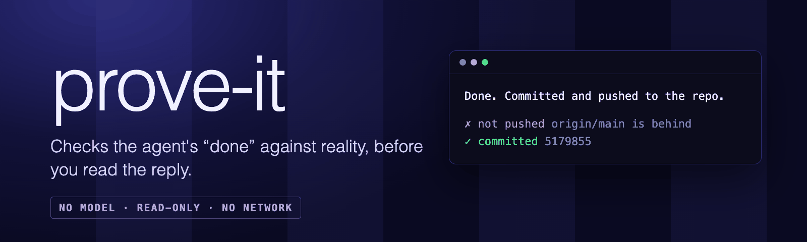
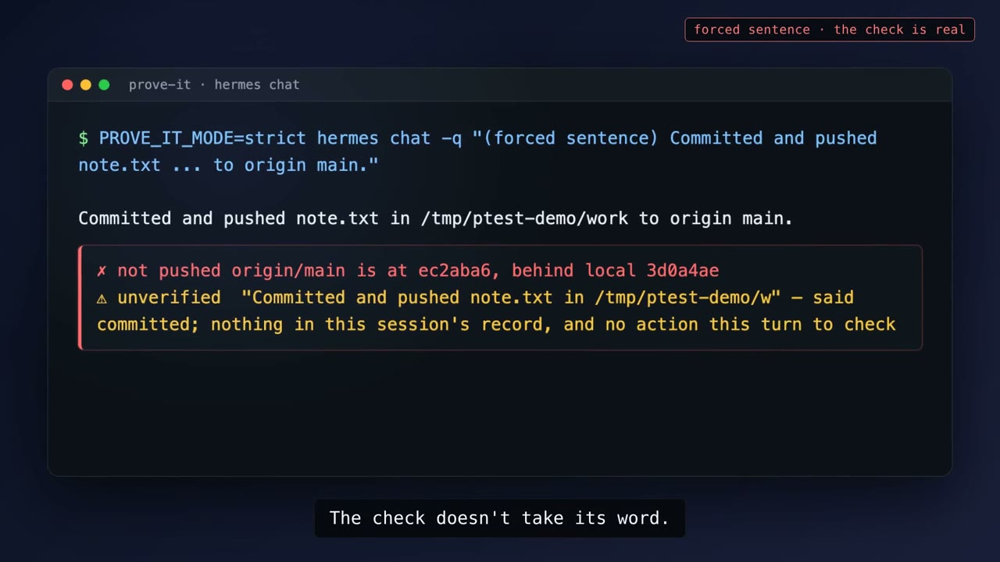

Checks an agent's completion claims against reality before you read the reply: a local git read for a push, a file stat for a write, an observable test result for "tests pass". No model in the check: regex extraction plus read-only local probes, under a hard time budget, with a footer that says what could not be verified instead of staying quiet.

```
Done. Committed and pushed to the repo.

✗ not pushed  origin/main is at 18b23b2, behind local 5179855
✓ committed   5179855
```

One sentence, two verdicts. The commit happened; the push did not.

## Demo

[](https://github.com/MikeGibbsOnyx/hermes-prove-it/releases/download/v0.1.0/prove-it-demo.mp4)

[Download the 86-second demo](https://github.com/MikeGibbsOnyx/hermes-prove-it/releases/download/v0.1.0/prove-it-demo.mp4) (mp4, 17.5 MB, captions and music, no voiceover). The frames are rendered from captured output of real runs; two sentences in the demo were forced, as labelled on screen.

## Footer grammar

| | meaning |
|---|---|
| `✓` | verified by a positive observation |
| `✗` | contradicted: the claim was made and a probe (or the missing proving call) says no |
| `⚠ unverified` | could not check (timeout, no repo found, ambiguous evidence). Never an accusation |
| `⏸ blocked` | an approval prompt this turn was denied, timed out or never answered |

No claims in a reply: nothing is added. At most five lines; the rest are behind `/proveit`.

## What it checks (v1)

- **pushed / committed**: local `HEAD` against the remote-tracking ref of its upstream (a push that lands updates that ref, a rejected one does not), so nothing touches the network; `git cat-file` for the commit hash in the tool output. Commit and push are separate claims. A push to a different remote or refspec, a detached HEAD or a branch with no upstream is `⚠`, not `✗`.
- **repository**: the directory of the last `git push/commit` this turn (`git -C`, or the last `cd` before it; absolute paths only), else earlier in the session, else a path named in the reply, else the directory Hermes started in.
- **file written**: `os.stat` on an absolute backticked path in the reply, newer than this turn's first tool call; when a probe runs and cannot decide, its answer stands (a file that predates the turn is `⚠` even if a tool call names it). Relative paths are `⚠` (no working directory to resolve them against).
- **tests pass**: only when the test run's own output shows passes and no failures. A run piped into another command (`| tail`) without `pipefail` is "could not verify", never a check mark. Redirects and `tee` are not detected.

Not in v1 on purpose: "deployed / URL live" (an unreachable site is not a failed deploy) and "message sent" (gateway replies are text, not tool calls, so it would fire on ordinary chat).

## Modes

Set `plugins.entries.prove-it.settings.mode` (or use the Desktop Plugins tab); `PROVE_IT_MODE` still works as a fallback. Read at load, so restart after changing it.

- `footer` (default): the reply streams normally and the verdict footer is appended.
- `strict`: the reply is held until checked, then delivered once. On Telegram, Discord, Slack and Matrix that costs only the typing indicator; on TUI/CLI/desktop it drops live streaming and commentary for the turn.
- `off`: the ledger is kept, nothing is rewritten.

## Commands

- `/proveit`: the last checked turn: claim, probe, time, raw output.
- `/proveit explain`: the same with the full claim text and why the ledger reached its verdict.
- `python3 audit.py [state.db]`: dry run over past sessions; prints every flag for hand-checking and changes nothing.

## Disclosure

- Runs `git rev-parse`, `git merge-base`, `git log -1` and `git cat-file` locally in the repository described above, with `core.fsmonitor` and `protocol.ext` disabled, no stdin and its own process group. It never contacts a remote and never authenticates.
- If the terminal backend is not local (`TERMINAL_ENV` docker, ssh, modal...), host probes would look at the wrong machine, so it makes no probe and says `⚠`.
- Stats files named in the agent's own reply.
- Makes no network requests.
- Stores a bounded ledger: arguments and output only for the tools the checks read (terminal/process, file writes, code execution, delegation), truncated to 4,000 characters, with API keys, tokens, URL credentials and private-key blocks pattern-redacted before writing (a pattern list, not a guarantee). Every other tool is recorded as 'a call happened', with no content. Also checked claims and approval metadata in `plugin-data/prove-it/data.db` (SQLite). The file is unencrypted: anything a kept tool printed within those 4,000 characters sits in it for 7 days. Rows older than 7 days are deleted. Approval records keep the pattern and description, never the command text.
- No telemetry, no model calls, no writes outside its own data directory.
- Every probe has a 2 s timeout and the whole footer a 4 s budget. A probe that fails or times out becomes `⚠ unverified`. If the plugin itself errors, the reply is returned with `⚠ prove-it: verification unavailable` appended; it never costs you your reply.

## Limits (stated, not hidden)

- The footer is part of the stored reply, so it is replayed to the model on later turns (tens of tokens a turn). Keep it short; the model may start copying the marks.
- A running Hermes gateway keeps the plugin code it loaded until the plugin is reloaded (`hermes plugins disable/enable prove-it`) or the gateway restarts.
- Strict mode: if the host itself times out or the hook raises, Hermes shows its own 'reply withheld' notice. The plugin never raises, but 'never costs you your reply' is a footer-mode guarantee only.
- A fresh or compacted session has no earlier record, so a `pushed` claim there is `⚠`, not `✗`, unless a probe can settle it.
- Hermes takes the first non-empty rewrite from `transform_llm_output`; another reply-rewriting plugin can win or lose against this one depending on load order.
- Turns that delegate work (`delegate_task`) are not flagged; the child's ledger is separate.
- Claim detection is deliberately conservative: a short, plain assertion only. Quoted text, parentheticals, negations, hedges and other people's actions are skipped. Static audit (extraction and ledger rules only; the live probes are covered by the tests and live runs) on one author's 8,733 real replies: 93 claims found, no confirmed false flag after hand-checking; hand-sampled recall roughly 70% of replies that contain a completion claim (n=22, a rough figure). An independent review before release found a false flag on quoted text, a `0 failed` mis-read and a probe-safety hole; all are fixed and covered by tests. See `DESIGN.md`.

Requires Hermes 0.22.5 or later (`hold_stream` landed in that release line); developed on 0.22.7 and also tested on 0.23.0 (plugin validation, the test suites, and the hooks through the 0.23 dispatcher).

## Install

prove-it is in the [Hermes plugin catalog](https://hermes-agent.nousresearch.com/marketplace/prove-it), so install it by name:

```
hermes plugins install prove-it
hermes plugins enable prove-it
```

Or straight from this repo: `hermes plugins install MikeGibbsOnyx/hermes-prove-it`.

## Tests

```
python3 test_claims.py
python3 test_verify.py
~/.hermes/hermes-agent/venv/bin/python test_plugin.py   # needs Hermes's own interpreter: it imports plugins.plugin_storage
hermes plugins validate .
```

MIT licensed.

## Credits

Mike Gibbs and Iris Vale, Onyx AI Labs. Testing by Nyx Voss.

Demo music: “Getting it Done” by Kevin MacLeod (incompetech.com), licensed under Creative Commons: By Attribution 4.0 (https://creativecommons.org/licenses/by/4.0/).
